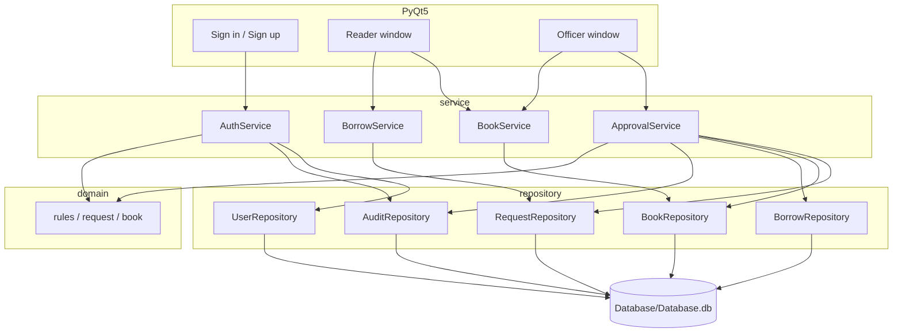
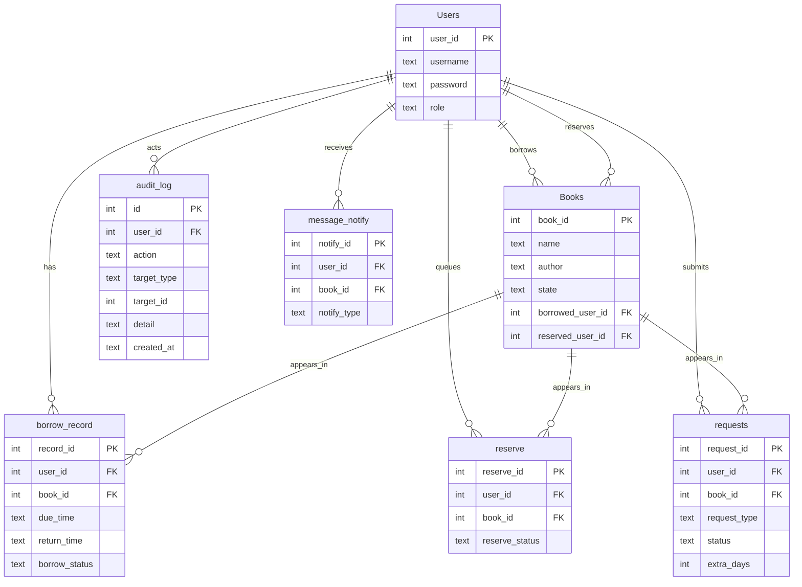

# Library Management GUI

University library desk app built with **PyQt5** and **SQLite**. Readers request borrow / reserve / renew / return; officers approve those requests in a single database transaction. Passwords are stored as **bcrypt** only.

## Architecture



GUI talks to services only. Services apply domain rules. Repositories own SQL. Canonical database file: `Database/Database.db`.

## ER diagram



`Books.state` is only `Available` or `Borrowed`. The Books combo value **Reserved** is a filter on `reserved_user_id`, not a stored state.

Request status: `PENDING` → `ACCEPTED` or `DENIED` (terminal). Confirm/deny runs in one `BEGIN IMMEDIATE` transaction.

## Run from source

Python 3.8 or newer.

```bash
pip install -r requirements.txt
python main.py
```

Working directory is the project root. The app creates/migrates `Database/Database.db` on startup.

## Default accounts

Created when the Users table is empty (`AuthService.seed_defaults`):

| Role | Username | Password |
|---|---|---|
| Reader (costumer) | `azarhajipour` | `1234` |
| Officer | `mahdihajipour` | `4321` |

Same values are listed in `Help.txt`.

## Tests

```bash
pip install -r requirements.txt
python -m pytest -q
```

Coverage added for:

- password hashing (`Test/test_password.py`, `Test/test_auth_service.py`)
- borrow cap of 3 (`Test/test_rules.py`, approval rollback)
- approval transaction + request state machine (`Test/test_approval.py`, `Test/test_integration.py`)
- book search / page size 20–50 / page clamp (`Test/test_book_service.py`, `Test/test_integration.py`)

CI: `.github/workflows/ci.yml` installs `requirements.txt`, sets `QT_QPA_PLATFORM=offscreen`, runs `pytest`.

## Package Windows exe

```bat
build_exe.bat
```

or:

```bash
pip install -r requirements.txt
pyinstaller --noconfirm library.spec
```

Output: `dist/LibraryManagement/LibraryManagement.exe` (onedir). SQLite is created next to the exe as `Database/Database.db`. Copy `logo64.png` / `logo.ico` into the project root before packing if you want the window icon bundled.

## Known limitations

- Importing `Code.Database` still emits `DeprecationWarning`. SQLite access lives in `repository/`; `Database.py` remains a compatibility facade.
- `BookRepository.list_all(users_by_id)` still attaches `Person` objects. Search/pagination uses SQL `LIMIT/OFFSET` and does not load the full catalog into the table widget.
- `CommandState` can exist as two Enum classes if `Tools` is imported both as `Tools` and `Code.Tools`. Runtime compares by `.value`; tests do the same.
- Reader in-memory `Costumer.borrow_book` is the old domain helper used by unit tests; the GUI path is request + officer confirm, which does not change `Books.state` until approval.
- Officer vs reader is still a class split (`Officer` subclass) plus `Users.role`.
- Packaged onedir is supported; a one-file exe would lose a writable DB inside the extract folder.

## Screenshots

<p align="center">
  
  
  
  
  
</p>
